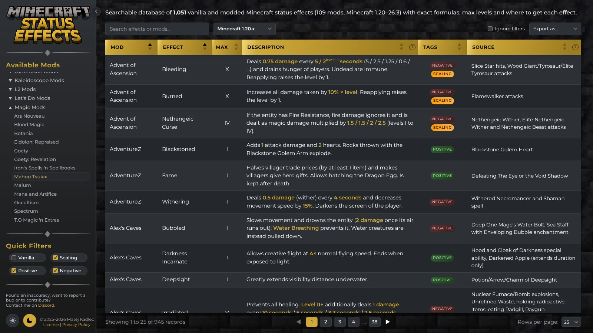

# Minecraft Status Effects


[](https://github.com/matejkadlec/status-effects/actions/workflows/tests.yml)

An interactive database of vanilla and modded Minecraft status effects – exact formulas, max
levels and where to get each effect – for every major version from 1.20 to 26.3.

**Live at [effects.matejkadlec.cz](https://effects.matejkadlec.cz).**



## Features

- **Versions** – pick Minecraft 1.20.x, 1.21.x, 26.1.x, 26.2.x or 26.3.x; effects that don't
  exist in a version disappear and the ones that changed show their version's behaviour.
- **1,000+ effects from 100+ mods** – vanilla plus big content mods (Iron's Spells, Apotheosis, Cataclysm,
  Alex's Mobs, Goety, Ars Nouveau, Malum, Born in Chaos, Farmer's Delight addons and many
  more), researched from the mods' source code and released jars.
- **Search, filters and sorting** – search all columns (every word must match, "quotes" for a
  phrase), quick filters, multi-column sorting (Shift+click) and pagination.
- **Mod navigation** – jump to any mod, grouped into collapsible groups; the sidebar collapses
  with Ctrl+B.
- **Exports** – CSV, Excel (styled in the current theme) or JSON, of the filtered table or the
  whole version.
- **Light and dark theme**, a table that fits the screen without horizontal scrolling and a
  card layout on phones.
- **SEO-friendly** – server-rendered table, canonical URL per version, JSON-LD `Dataset`,
  sitemap; no cookies, no tracking, no third-party requests.

## Running locally

```bash
./run.sh            # http://localhost:8000 with auto-reload (creates ./venv on the first run)
./run.sh test       # pytest + JavaScript tests
./run.sh lint       # ruff + the effect writing rules
./run.sh prod       # production mode behind a reverse proxy
```

Requires Python 3.12+; Node.js 22+ only for the JavaScript tests.

Production runs the Docker image (`Dockerfile`, `compose.yml`) behind a Cloudflare Tunnel and
is deployed automatically from `master`; see "Deployment" in [`AGENTS.md`](AGENTS.md).

## Data

The effects live in [`data/effects.json`](data/effects.json) (one record per effect, with
per-version differences) and [`data/mods.json`](data/mods.json). The format and the writing
rules are described in [`AGENTS.md`](AGENTS.md); `python tests/effect_rules.py <file>` checks
them.

## Contributing

Found an inaccuracy or a missing effect? Open an issue or a pull request, or contact me on
[Discord](https://discord.com/users/jimmorioriarty).

## License

The code and the data are licensed under the [PolyForm Shield License 1.0.0](LICENSE.md): you
can use, change and share them for anything except a product that competes with this site.
Keep the required notices and, ideally, link back to this repository.

NOT AN OFFICIAL MINECRAFT PRODUCT. NOT APPROVED BY OR ASSOCIATED WITH MOJANG OR MICROSOFT.
